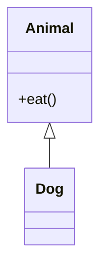

# code-visualizer

写代码 + 代码可视化助手。面向 **Python (.py)**、**C (.c/.h)** 与 **JS/TS (.js/.jsx/.ts/.tsx)**，把代码结构画成图，让依赖、继承、调用关系一眼可见。

## 功能

| 效果 | 命令 | 支持语言 |
|------|------|----------|
| 整个项目依赖关系图 | `code_graph.py deps <目录>` | Python / C / JS-TS |
| 单文件类图（继承 / 方法 / 属性） | `code_graph.py classes <文件>` | Python / C(struct) / JS-TS |
| 单文件函数调用链 | `code_graph.py calls <文件>` | Python / C |
| 目录 / 文件结构树 | `code_graph.py tree <目录>` | 全部 |

- 零依赖：只用 Python 标准库（`ast` / `re`）。
- 输出 Mermaid 文本，可自行渲染；加 `--html <path>` 直接生成可在浏览器打开的自包含图。
- 图过大自动 `--limit N` 截断（默认 60）。

## 安装（WorkBuddy 技能）

把整个 `code-visualizer/` 文件夹复制到用户技能目录即可，跨项目生效：

```
# Windows
C:\Users\<你的用户名>\.workbuddy\skills\code-visualizer\

# macOS / Linux
~/.workbuddy/skills/code-visualizer/
```

安装后在对话里直接说，例如：

- "帮我画下这个项目的结构"
- "把这个类的继承关系可视化"
- "看下函数调用链"
- "生成代码并配图"

## 用法

用托管 Python 运行（也可用任意 Python 3.10+）：

```bash
# 项目依赖图，并导出可打开的 HTML
python scripts/code_graph.py deps ./my-project --html deps.html

# 单个文件的类图
python scripts/code_graph.py classes ./my-project/pkg/base.py

# 函数调用链
python scripts/code_graph.py calls ./my-project/pkg/main.py

# 目录结构树
python scripts/code_graph.py tree ./my-project
```

### 示例输出（Mermaid）

依赖图：


类图：



## 渲染方式

1. **对话内实时预览**：用支持 Mermaid 的组件加载文本（如 `<div class="mermaid">…</div>` 引 mermaid CDN）。
2. **浏览器打开**：`--html` 生成的 `.html` 文件，用浏览器打开即可缩放 / 导出。

Mermaid 语法细节见 [`references/mermaid-cheatsheet.md`](references/mermaid-cheatsheet.md)。

## 目录结构

```
code-visualizer/
├── SKILL.md                      # 技能说明与触发规则
├── README.md                     # 本文件
├── scripts/
│   └── code_graph.py             # 解析脚本（零依赖）
└── references/
    └── mermaid-cheatsheet.md     # Mermaid 语法速查
```

## 说明

- `calls` 为单文件内分析；跨文件调用图需整项目级分析，后续可按需扩展。
- JS/TS 与 C 的类图、依赖图为正则解析（尽力而为），Python 为 `ast` 精确解析。
- C 没有类继承，`classes` 展示 `struct` 的字段，并通过 `*--` 标出 struct 之间的组合关系（如 `struct Node* next`）。
- C 的依赖图只统计项目内 `#include "..."`（引号）包含，系统头文件 `<...>` 自动忽略。
